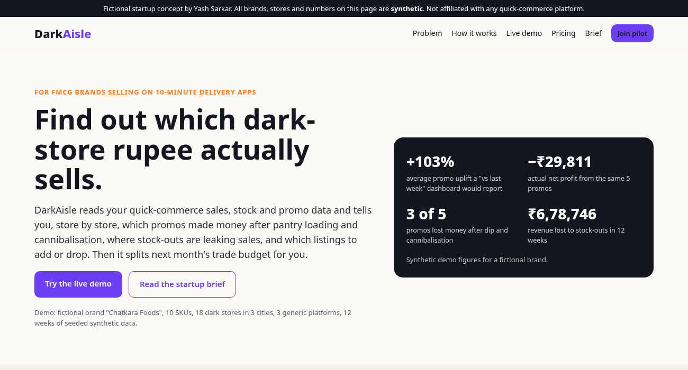
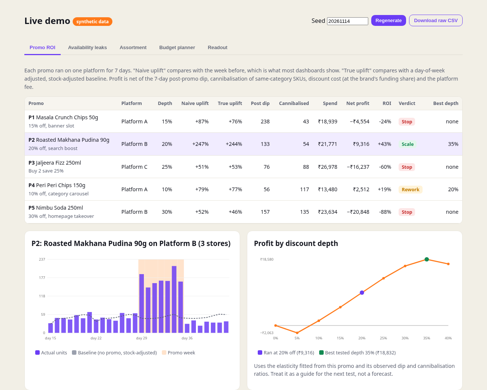

# DarkAisle: quick-commerce growth OS for FMCG brands (fictional startup concept)

**Live landing page + demo:** https://yashsarkar1806-creator.github.io/darkaisle-qcom-growth/
**Startup brief:** [docs/BRIEF.md](docs/BRIEF.md)

> **Fictional startup concept and portfolio project.** DarkAisle, the demo brand "Chatkara Foods", its SKUs, dark stores and every number shown are **synthetic** and generated in the browser from a fixed seed. Platforms are generic placeholders ("Platform A/B/C"). Not affiliated with any quick-commerce company, and no real client or employer data is used.



## The idea in 30 seconds

FMCG brands now spend serious trade money on 10-minute delivery apps (discounts, banner and search slots, listing fees), but the reports they get flatter them. Promo week is compared with last week, while the **dip after the promo** (shoppers stocked up), **cannibalisation** of the brand's own SKUs and **stock-outs** stay invisible.

DarkAisle is a concept for a brand-side tool that reads store-level sales, stock and promo data and answers four questions:

| Question | What the demo does |
| --- | --- |
| **Did this promo make money?** | Builds a weekday-adjusted, stock-adjusted baseline per dark store × SKU from clean nearby days, then nets out the 7-day post-promo dip and same-category cannibalisation. Profit is priced at real unit margin, the brand's funding share and the platform fee, and each promo gets a **Scale / Rework / Stop** verdict. |
| **What discount should we run next time?** | Fits elasticity from the promo (`ln(1 + uplift) / depth`) and plots profit at 0–40% off, highlighting the best tested depth (or "none beats running no promo"). |
| **Where are stock-outs leaking sales?** | Values lost sales as baseline × (1 − in-stock share), ranked by store × SKU and cut by city and platform, with CSV export. |
| **What should we list or drop, and how should we split the budget?** | Finds **range gaps** (SKUs unlisted in a store but selling in ≥ 2 same-city stores, scaled by a store size index) and **tail listings**, then allocates a monthly budget across availability fixes, promos, new listings and sponsored ads using diminishing-returns curves and a payback hurdle. |

A plain-English **readout** ties it together, for example: *"Scale: P2 Roasted Makhana Pudina 90g (ROI 43%)… Stop or redesign: P5 Nimbu Soda 250ml at 30% off (ROI -88%, no profitable depth found)… Hold back ₹65,000, the next step would not pay back."*



## What's in the landing page

Hero with live headline numbers from the demo · problem · how it works · **live demo** (5 tabs, seed control, raw CSV download) · concept pricing in INR and AUD · startup brief summary · pilot form. The form sends nothing: it saves the role locally (not the email) and pushes a `generate_lead` event to `window.dataLayer`. CTA clicks, tab views, promo/store selections, lever edits and downloads are also tracked as GA4-style dataLayer events, to show the measurement plan.

## Startup brief

[docs/BRIEF.md](docs/BRIEF.md) covers the problem, target customer (Indian D2C-born and mid-size FMCG brands first, Australian challenger brands second), positioning, product modules, go-to-market (free "promo post-mortem" lead magnet, LinkedIn content, founder-led outbound, agency partners), pricing hypothesis (free pilot, ₹39,000 / month Growth plan, Enterprise), key metrics (north star: incremental margin found per customer per month) and risks.

## Synthetic data, with a known truth

`src/data.js` generates 84 days × 18 dark stores (Bengaluru, Mumbai, Delhi NCR) × up to 10 SKUs (chips, namkeen, drinks), about 13,000 daily rows. It includes city taste differences, weekday seasonality, a slow trend, partial and chronic stock-outs, deliberate listing gaps, and 5 promos with hidden "true" elasticities, a pantry-loading dip and cannibalisation. Because the truth is known, the tests check that the engine **recovers the hidden elasticities to within 25%**. `npm run demo-data` writes the dataset and promo results to `data/` as CSV.

## Run locally

```bash
python3 -m http.server 8080   # open http://localhost:8080  (add ?seed=42 or ?tab=budget)
npm test                      # 15 Node unit tests, no dependencies
npm run demo-data             # regenerate the synthetic CSVs in data/
```

## Project structure

```
index.html              Landing page + live demo
styles.css
src/data.js             Seeded synthetic data generator (fictional brand, stores, promos)
src/engine.js           Baselines, promo ROI, depth curve, availability loss, assortment, budget allocator, readout, CSV
src/app.js              Rendering, SVG charts, interactions, dataLayer events
test/engine.test.js     Node unit tests (node:test)
scripts/generate-demo.mjs
docs/BRIEF.md           Startup brief
data/                   Synthetic CSV exports
```

## Limitations (honest notes)

- The baseline is deliberately simple (a local, weekday-adjusted mean of clean days). A production version would add holdout stores, price and competitor effects and proper uncertainty intervals.
- The budget curves for availability, promos and listings are derived from the analysis; the sponsored-ads curve is an editable assumption, not data.
- The depth curve extrapolates one observed promo, so it is a guide for the next test, not a forecast.

## About

Built by Yash Sarkar as a growth and brand marketing portfolio piece: FMCG, quick commerce, trade promotion and retail analytics. MIT licence.
